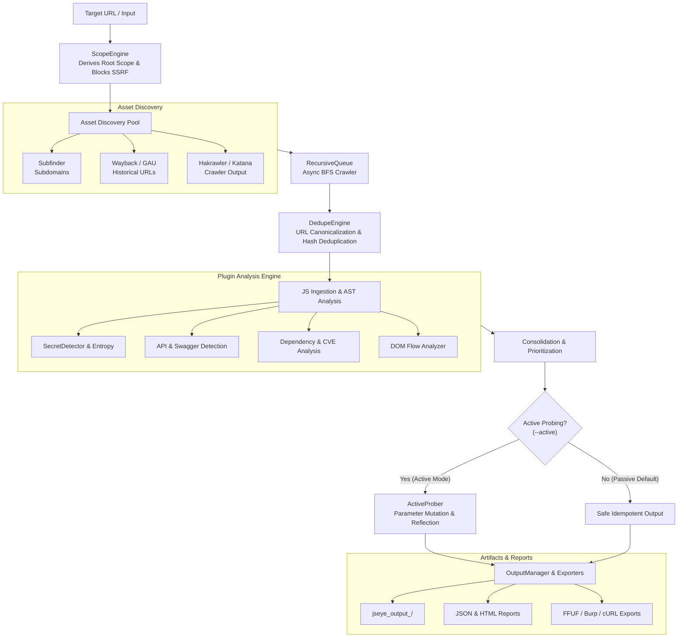

# JSEye

<div align="center">

**JavaScript Intelligence & Attack Surface Discovery Engine**

[](https://github.com/l3tchupkt/JSEye/actions/workflows/ci.yml)
[](https://github.com/l3tchupkt/JSEye/releases)
[](https://pypi.org/project/jseye/)
[](https://pypi.org/project/jseye/)
[](https://opensource.org/licenses/MIT)

</div>

---

## 1. Introduction

Modern web applications increasingly execute critical business routing, authentication handshakes, and API interactions entirely within client-side JavaScript. This architecture frequently leaves sensitive administrative routes, unpublished API schemas, internal parameters, and cryptographic credentials exposed within minified script bundles.

**JSEye** is an offensive security reconnaissance and JavaScript intelligence engine built for:

- **Bug Bounty Hunters** mapping undocumented attack surfaces and hidden endpoints.
- **Penetration Testers** auditing modern Single Page Applications (SPAs) and complex API ecosystems.
- **Application Security Engineers** identifying accidental credential disclosure and vulnerable dependencies before release.
- **Security Researchers** performing automated, large-scale asset discovery.

JSEye automates the entire JavaScript reconnaissance lifecycle: discovering live and historical scripts, tracing imports and routes, extracting hidden endpoints and parameters, identifying exposed credentials and supply-chain vulnerabilities, and generating ready-to-use artifacts for downstream security tools.

---

## 2. Key Capabilities

### 🔍 JavaScript Reconnaissance
- **Automatic Scope Derivation**: Automatically calculates the registered domain and subdomain scope from any target URL using Public Suffix data—no manual scope files needed.
- **Asynchronous BFS Queue**: Discovers scripts, links, and API references with bounded concurrency, rate limits, and recursion controls.
- **Multi-Source Discovery**: Unifies historical script archives from the Wayback Machine, Common Crawl via GAU, subdomains from Subfinder, and crawler output from Hakrawler and Katana.
- **Global Deduplication**: Canonicalizes URLs, normalizes cache-busters, hashes response payloads, and eliminates pagination loops.

### 🌐 API Intelligence & Mapping
- **Route & Endpoint Discovery**: Identifies REST paths, versioned endpoints (`/v1/`, `/v2/`), administrative consoles, and internal debugging interfaces.
- **Schema & Specification Parsing**: Automatically identifies Swagger UI, OpenAPI v2/v3 definitions, and GraphQL endpoints.
- **Parameter Extraction**: Discovers parameter names from URL queries, fetch/XHR calls, and HTML form inputs for fuzzing wordlists.

### 🛡️ Security Analysis
- **Context-Aware Secret Detection**: Evaluates string patterns alongside Shannon entropy scoring, variable context, and authorization header usage. Distinguishes structural validity (`format_valid`) from live-verified credentials.
- **Live Google API Key Validation**: Non-destructively probes Google API endpoints to confirm whether discovered API keys are active.
- **Dependency Confusion & Supply-Chain Analysis**: Scans for exposed `package.json` manifests, evaluates private namespace packages (`@scoped`, `-internal`), and checks public NPM registries for takeover risks.
- **CVE Intelligence**: Fingerprints third-party JavaScript libraries and cross-references public vulnerability databases (OSV, NVD).
- **DOM XSS & Flow Tracking**: Traces untrusted DOM sources (e.g. `location.search`, `window.name`) to dangerous sinks (e.g. `eval`, `innerHTML`).
- **Source Map Acquisition**: Locates and retrieves remote `.map` files to reconstruct source code structures.

### 🎯 Prioritization & Actionable Reporting
- **Noise Filtering**: Suppresses analytics, tracking scripts, and static media to prioritize high-value security signals.
- **Risk Scoring**: Categorizes findings by severity (Critical, High, Medium, Low) and actionability.
- **Downstream Automation Exports**: Generates ready-to-run FFUF fuzzing commands, Burp Suite XML site maps, and cURL reproduction scripts.
- **Multi-Format Reports**: Exports structured JSON and interactive HTML reports.

---

## 3. Architecture

JSEye organizes reconnaissance into distinct, modular phases with safe default execution boundaries:



---

## 4. Installation

### Prerequisites

- **Python**: 3.8, 3.9, 3.10, 3.11, 3.12, or 3.13
- **pip**: Modern pip (`python -m pip install --upgrade pip`)
- **Operating System**: Linux, macOS, or Windows

### Option A: Install from PyPI

```bash
pip install jseye
```

### Option B: Install from GitHub Source

```bash
git clone https://github.com/l3tchupkt/JSEye.git
cd JSEye
pip install -e .
```

### Optional: Headless Browser Support (Playwright)

For dynamic DOM rendering and deep client-side routing extraction:

```bash
pip install "jseye[headless]"
playwright install chromium
```

### Optional: External Go Recon Tools

JSEye runs natively without external tools. However, if available in your system `$PATH`, JSEye will automatically leverage them for broader reconnaissance:

- `subfinder` — Subdomain enumeration
- `gau` — Historical URL mining
- `hakrawler` — Web crawling
- `katana` — Dynamic crawling
- `mantra` — Secret discovery

If an external tool is not installed, JSEye skips that phase gracefully and proceeds with its native Python engines.

---

## 5. Quick Start

> [!IMPORTANT]
> Always ensure you have explicit written authorization before scanning target domains.

### 1. Basic Passive Scan
Scans the target, automatically derives scope, discovers JavaScript files, and extracts endpoints and secrets without sending state-changing requests:

```bash
jseye https://example.com
```

### 2. Host-Only Scan (Skip Subdomain Enumeration)
Restricts discovery exclusively to the specified target host:

```bash
jseye https://example.com --no-subs
```

### 3. High-Priority Actionable Mode
Filters out framework noise and highlights high-signal findings:

```bash
jseye https://example.com --actionable
```

### 4. Active Mutation & Reflection Probing
Actively probes prioritized parameters for reflection, CORS misconfigurations, and authentication anomalies:

```bash
jseye https://example.com --active
```

### 5. Generate Reports and Custom Exports
Saves structured JSON, HTML, and automation artifacts to a custom directory:

```bash
jseye https://example.com -o ./scan_results --json --html --export-ffuf ffuf.sh --export-burp burp.xml
```

### 6. Verify Installation and Version

```bash
jseye --version
jseye --help
```

---

## 6. CLI Reference

```
usage: jseye [-h] [--all] [--actionable] [--aggressive-filter] [--show-all]
             [--export-wordlist EXPORT_WORDLIST] [--export-params EXPORT_PARAMS]
             [--export-ffuf EXPORT_FFUF] [--export-curl EXPORT_CURL]
             [--export-burp EXPORT_BURP] [--export-nuclei EXPORT_NUCLEI]
             [-o OUTPUT] [--json] [--html] [--no-json] [--no-html]
             [--threads THREADS] [--timeout TIMEOUT] [--headless]
             [--list-plugins] [--disable-plugin DISABLE_PLUGIN]
             [--enable-plugin ENABLE_PLUGIN] [--profile-scan]
             [--generate-graph] [--compare COMPARE] [--no-subs]
             [--no-wayback] [--no-gau] [--no-secrets] [--no-api] [--active]
             [--intruder-lite] [--aggressive] [--max-depth MAX_DEPTH]
             [--max-requests MAX_REQUESTS] [--silent] [--verbose] [--version]
             [target]
```

### Target & Scope
| Argument | Description |
|---|---|
| `target` | Target domain or URL (e.g., `https://example.com`). |
| `--no-subs` | Disable subdomain enumeration; constrain scan strictly to the target host. |

### Scan Modes & Triage
| Argument | Description |
|---|---|
| `--actionable` | Display only actionable, high-probability security findings. |
| `--show-all` | Disable noise filtering to inspect every raw candidate. |
| `--all` | Comprehensive scan with all native engines enabled and all export formats generated. |

### Active Probing
| Argument | Description |
|---|---|
| `--active` | Enable controlled active probing (baseline requests, parameter mutations, reflection checks). |
| `--intruder-lite` | Alias for `--active`. |
| `--aggressive` | Extended active fuzzing payload set (implies `--active`). |

### Concurrency & Performance
| Argument | Description |
|---|---|
| `--threads` | Number of concurrent workers (default: `20`). |
| `--timeout` | HTTP request timeout in seconds (default: `10`). |
| `--max-depth` | Maximum crawl recursion depth (default: unlimited). |
| `--max-requests` | Maximum total HTTP requests before terminating crawl (default: unlimited). |
| `--headless` | Enable headless Chromium analysis via Playwright for dynamic scripts. |

### Discovery Toggles
| Argument | Description |
|---|---|
| `--no-wayback` | Disable Wayback Machine historical URL discovery. |
| `--no-gau` | Disable GAU integration. |
| `--no-secrets` | Disable secret and credential analysis. |
| `--no-api` | Disable API endpoint analysis. |

### Output & Reports
| Argument | Description |
|---|---|
| `-o`, `--output` | Destination output directory (default: `jseye_output_<timestamp>/`). |
| `--json` | Generate structured JSON report (default: enabled). |
| `--html` | Generate interactive HTML report (default: enabled). |
| `--no-json` | Disable JSON report generation. |
| `--no-html` | Disable HTML report generation. |
| `--compare <file>` | Compare scan results against a baseline JSON report. |

### Tactical Exports
| Argument | Description |
|---|---|
| `--export-wordlist <file>` | Export discovered path and endpoint wordlists. |
| `--export-params <file>` | Export discovered parameter wordlists. |
| `--export-ffuf <file>` | Generate executable FFUF fuzzing commands. |
| `--export-curl <file>` | Generate cURL reproduction scripts. |
| `--export-burp <file>` | Generate Burp Suite site map XML. |
| `--export-nuclei <file>` | Generate tailored Nuclei templates. |

### Plugins & Diagnostics
| Argument | Description |
|---|---|
| `--list-plugins` | List all discovered plugins and exit. |
| `--disable-plugin <name>`| Disable a specific plugin by name. |
| `--enable-plugin <name>` | Enable a specific plugin by name. |
| `--profile-scan` | Enable performance and memory profiling. |
| `--generate-graph` | Generate attack surface relationship graph. |
| `-v`, `--verbose` | Enable verbose debug output. |
| `--silent` | Suppress banner and console telemetry; minimal output. |
| `--version` | Display version information and exit. |

---

## 7. Execution Workflow

When a scan is initiated, JSEye executes through eleven standardized phases:

1. **Target Initialization**: Normalizes target scheme, host, and port.
2. **Scope Derivation**: Evaluates registered domain boundaries using Public Suffix data and installs SSRF protection rules.
3. **Subdomain Enumeration**: Discovers sibling and child assets (unless `--no-subs` is set).
4. **Historical Asset Mining**: Queries web archives (Wayback, GAU) for historical JavaScript endpoints.
5. **Autonomous Recursive Queue**: Crawls in-scope URLs to uncover dynamically linked scripts, stylesheets, and endpoints.
6. **Script Ingestion**: Concurrently downloads scripts, strips comments safely, and attempts source map discovery (`.map`).
7. **Static Plugin Analysis**: Executes the plugin pipeline (Secret detection, AST parsing, DOM flows, API signatures, CVE correlation, package.json supply-chain checks).
8. **Consolidation & Deduplication**: Canonicalizes findings, deduplicates URLs by structure and payload hash, and unifies parameter names.
9. **Finding Prioritization**: Applies multi-factor risk weighting and filters low-signal analytics patterns.
10. **Active Probing (Optional)**: If `--active` is enabled, baseline HTTP requests and safe parameter mutations are evaluated for reflections and auth anomalies.
11. **Report & Artifact Serialization**: Writes results to `jseye_output_<timestamp>/` and renders JSON/HTML reports.

---

## 8. Output Formats

Scans generate a structured output folder containing categorized artifacts:

```
jseye_output_<timestamp>/
├── urls/
│   ├── all_urls.txt          # Every URL discovered during crawl
│   ├── unique_urls.txt       # Canonicalized unique URLs
│   └── in_scope_urls.txt     # Strictly in-scope URLs
├── endpoints/
│   ├── endpoints.json        # Discovered endpoints with methods
│   └── prioritized_endpoints.json # Ranked endpoints for testing
├── parameters/
│   ├── all_params.txt        # Discovered parameter names
│   └── high_risk_params.txt  # Auth, redirect, and sensitive params
├── secrets/
│   ├── secrets.json          # Pattern and entropy findings
│   └── validated_secrets.json# Live-verified credentials
├── requests/
│   └── captured_requests.json# Baseline and mutated probe requests
├── exports/
│   ├── ffuf_commands.sh      # Executable FFUF fuzzing commands
│   ├── curl_replay.sh        # cURL verification scripts
│   ├── burp_sitemap.xml      # Burp Suite importable site map
│   └── wordlists.txt         # Tailored wordlists
├── final_report.json         # Complete machine-readable findings
└── final_report.html         # Interactive visual report
```

### Understanding Finding Status
To maintain report integrity, JSEye distinguishes detection stages:
- `format_valid: true` — The finding matches structural specifications (e.g. valid AWS access key format or valid JWT structure).
- `validated: false` — The finding was detected statically and has **not** been probed against external provider APIs.
- `validated: true` — The credential was actively confirmed against an authorized provider API (e.g. Gemini / Google API validation).

---

## 9. Security & Responsible Usage

### Passive Invariance
In default (passive) mode, JSEye **never** issues state-changing HTTP requests (`POST`, `PUT`, `DELETE`, `PATCH`). Passive scans only issue safe, read-only requests (`GET`, `OPTIONS`, `HEAD`).

### SSRF Prevention
To protect against Server-Side Request Forgery and unintended internal network exposure:
- JSEye blocks recursive crawling and active probing of private RFC1918 subnets (`10.0.0.0/8`, `172.16.0.0/12`, `192.168.0.0/16`), loopback (`127.0.0.0/8`, `::1`), link-local, and cloud metadata addresses (`169.254.169.254`).
- Local testing is permitted only when the operator explicitly specifies a local IP or hostname as the target.
- Protocol-relative URLs (`//evil.com/payload.js`) are normalized and subject to scope checks.

### Legal Disclaimer
JSEye is designed strictly for authorized security assessments, bug bounty testing, penetration testing, and defensive auditing. Unauthorized access to computer systems, networks, or data is illegal. Users are solely responsible for complying with all applicable local, state, and federal laws.

---

## 10. Development & Testing

### Setting Up a Development Environment

```bash
# Clone the repository
git clone https://github.com/l3tchupkt/JSEye.git
cd JSEye

# Create and activate a virtual environment
python -m venv venv
source venv/bin/activate  # On Windows: .\venv\Scripts\Activate.ps1

# Install development dependencies
pip install -e ".[dev]"
```

### Running the Test Suite

```bash
# Run all tests with verbose output
pytest -v

# Run with coverage report
pytest --cov=jseye tests/
```

### Code Formatting & Static Analysis

```bash
# Check code style with Ruff
ruff check jseye

# Run Bandit security audit
bandit -r jseye -ll
```

### Building Distribution Packages

```bash
# Build wheel and source distribution
python setup.py sdist bdist_wheel

# Check package validity with Twine
twine check dist/*
```

---

## 11. Roadmap

- [ ] SARIF report format export for GitHub Code Scanning integration.
- [ ] Additional non-destructive credential verification plugins (AWS STS, Slack Auth).
- [ ] Distributed scanning worker support.
- [ ] Webhook notifications for Slack and Discord alerts.

---

## 12. License & Acknowledgments

JSEye is released under the [MIT License](LICENSE).

Authored and maintained by **Lakshmikanthan K** ([@l3tchupkt](https://github.com/l3tchupkt)).

Special thanks to the authors and maintainers of the open-source security tools and libraries that inspired or integrate with JSEye, including `tldextract`, `aiohttp`, `Playwright`, `Rich`, `waybackpy`, `gau`, `subfinder`, and `katana`.
