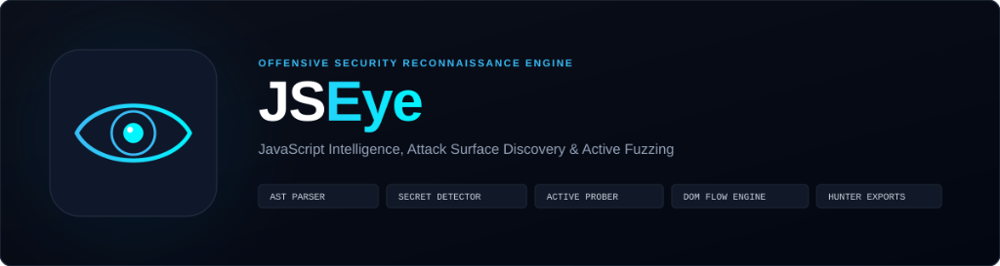
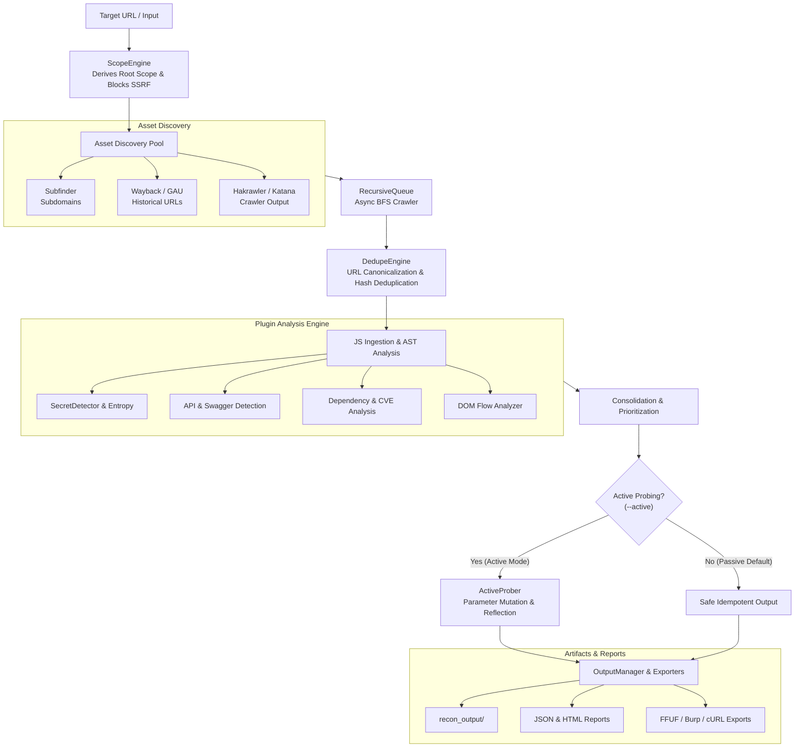

<p align="center">
  
</p>

<p align="center">
  <a href="https://github.com/l3tchupkt/JSEye/actions/workflows/ci.yml"></a>
  <a href="https://pypi.org/project/jseye/"></a>
  <a href="https://pypi.org/project/jseye/"></a>
  <a href="https://opensource.org/licenses/MIT"></a>
  <a href="https://github.com/l3tchupkt/JSEye/releases"></a>
</p>

<p align="center">
  <b>Advanced JavaScript Intelligence, Recursive Reconnaissance &amp; Attack Surface Discovery Engine</b>
</p>

---

## 1. Executive Overview

Modern web applications execute critical business logic, routing, authentication flows, and API interactions within client-side JavaScript. This architecture frequently leaves sensitive administrative routes, unpublished API schemas, internal parameters, and cryptographic credentials exposed within minified script bundles.

**JSEye** is an offensive security reconnaissance and JavaScript intelligence engine designed for:

- **Bug Bounty Hunters** mapping undocumented attack surfaces, hidden endpoints, and query parameters.
- **Penetration Testers** auditing modern Single Page Applications (SPAs) and complex API ecosystems.
- **Application Security Engineers** identifying hardcoded credentials and vulnerable dependencies prior to production deployment.
- **Security Researchers** performing automated, large-scale asset discovery and DOM data-flow analysis.

JSEye automates the entire JavaScript reconnaissance lifecycle: discovering live and historical scripts, tracing imports and routes, extracting hidden endpoints and parameters, identifying exposed credentials and supply-chain vulnerabilities, and generating ready-to-use artifacts for downstream security tools (`ffuf`, Burp Suite, cURL, and Nuclei).

---

## 2. Key Capabilities

### JavaScript Reconnaissance & Crawling
- **Automatic Scope Derivation**: Automatically calculates the registered root domain and subdomain scope from any target URL using Public Suffix data—no manual scope files needed.
- **Asynchronous BFS Queue**: Discovers scripts, links, and API references with bounded concurrency, rate limits, and recursion controls.
- **Multi-Source Discovery**: Unifies historical script archives from the Wayback Machine, Common Crawl via GAU, subdomains from Subfinder, and crawler output from Hakrawler and Katana.
- **Global Deduplication**: Canonicalizes URLs, normalizes cache-busters, hashes response payloads, and eliminates pagination loops.

### API Intelligence & Mapping
- **Route & Endpoint Discovery**: Identifies REST paths, versioned endpoints (`/v1/`, `/v2/`), administrative consoles, and internal debugging interfaces.
- **Schema & Specification Parsing**: Automatically identifies Swagger UI, OpenAPI v2/v3 definitions, and GraphQL endpoints.
- **Parameter Extraction**: Discovers parameter names from URL queries, fetch/XHR calls, and HTML form inputs for fuzzing wordlists.

### Deep Security Analysis
- **Context-Aware Secret Detection**: Evaluates regex patterns alongside Shannon entropy scoring, variable context, and authorization header usage. Distinguishes structural validity (`format_valid`) from live-verified credentials.
- **Live Google API Key Validation**: Non-destructively probes authorized Google API endpoints to confirm whether discovered API keys are active.
- **Dependency Confusion & Supply-Chain Analysis**: Scans for exposed `package.json` manifests, evaluates private namespace packages (`@scoped`, `-internal`), and checks public registries for takeover risks.
- **CVE Intelligence**: Fingerprints third-party JavaScript libraries and cross-references public vulnerability databases (OSV, NVD).
- **DOM XSS & Flow Tracking**: Traces untrusted DOM sources (e.g. `location.search`, `window.name`) to dangerous sinks (e.g. `eval`, `innerHTML`).
- **Source Map Acquisition**: Locates and retrieves remote `.map` files to reconstruct original source code structures.

### Downstream Hunter Integration
- **Tactical Artifact Generation**: Automatically exports ready-to-run FFUF fuzzing commands, Burp Suite XML site maps, tailored parameter wordlists, and cURL reproduction scripts.
- **Multi-Format Reports**: Exports both machine-readable JSON and fully responsive, interactive HTML dashboards.

---

## 3. Architecture

JSEye organizes reconnaissance into distinct, modular phases with safe default execution boundaries:



---

## 4. Installation

### Requirements
- **Python**: 3.8, 3.9, 3.10, 3.11, 3.12, or 3.13
- **Operating System**: Linux, macOS, or Windows

### Install via PyPI (Recommended)

```bash
pip install jseye
```

### Install from Source

```bash
git clone https://github.com/l3tchupkt/JSEye.git
cd JSEye
pip install -e .
```

### Optional External Go Helpers

JSEye is completely self-contained and operates out-of-the-box using native Python parsers and network engines. If you wish to leverage optional external Go reconnaissance utilities (`subfinder`, `gau`, `katana`, `hakrawler`, `mantra`), JSEye detects them automatically in your `$PATH`.

To have JSEye attempt to install missing external tools automatically:

```bash
jseye --install-tools
```

---

## 5. Quick Start

> [!IMPORTANT]
> Always ensure you have explicit written authorization before scanning target domains.

### 1. Basic Passive Scan
Scans the target, automatically derives scope, discovers JavaScript files, and extracts endpoints and secrets without sending state-changing requests:

```bash
jseye https://example.com
```

### 2. Host-Only Scan (Skip Subdomain Enumeration)
Restricts discovery exclusively to the specified target host:

```bash
jseye https://example.com --no-subs
```

### 3. High-Priority Actionable Mode
Filters out framework noise and highlights high-signal findings:

```bash
jseye https://example.com --actionable
```

### 4. Active Mutation & Reflection Probing
Actively probes prioritized parameters for reflection, CORS misconfigurations, and authentication anomalies:

```bash
jseye https://example.com --active
```

### 5. Ultimate Hunter Mode
Enables all analysis features and automatically exports all wordlists, Burp XML, and FFUF scripts:

```bash
jseye https://example.com --all -o ./hunt_results
```

---

## 6. Modular Plugin Architecture

JSEye is designed around an extensible plugin pipeline. Inspect installed plugins anytime:

```bash
jseye --list-plugins
```

### Built-in Core Plugins

| Plugin | Category | Execution Order | Description |
|---|---|:---:|---|
| `api_intelligence` | Intelligence | 120 | Analyzes API routes, version paths, and Swagger/OpenAPI endpoints. |
| `ast_analysis` | Analysis | 150 | Abstract Syntax Tree parsing of JavaScript files to extract variables and endpoints. |
| `cve_intelligence` | Intelligence | 110 | Correlates discovered libraries against OSV and NVD CVE databases. |
| `dom_flow_analysis`| Analysis | 100 | Traces DOM sources (`location.search`) to dangerous sinks (`innerHTML`, `eval`). |
| `google_api_key_validator` | Detection | 90 | Detects Google API keys and validates active scopes non-destructively. |
| `secret_detection` | Detection | 80 | Shannon entropy analysis and context-aware pattern scanning for secrets. |

---

## 7. CLI Reference

<details open>
<summary><b>Click to expand / collapse full CLI options</b></summary>

```
usage: jseye [-h] [--all] [--actionable] [--aggressive-filter] [--show-all]
             [--export-wordlist EXPORT_WORDLIST] [--export-params EXPORT_PARAMS]
             [--export-ffuf EXPORT_FFUF] [--export-curl EXPORT_CURL]
             [--export-burp EXPORT_BURP] [--export-nuclei EXPORT_NUCLEI]
             [-o OUTPUT] [--json] [--html] [--no-json] [--no-html]
             [--threads THREADS] [--timeout TIMEOUT] [--headless]
             [--list-plugins] [--disable-plugin DISABLE_PLUGIN]
             [--enable-plugin ENABLE_PLUGIN] [--profile-scan]
             [--generate-graph] [--compare COMPARE] [--no-subs]
             [--no-wayback] [--no-gau] [--no-secrets] [--no-api] [--active]
             [--intruder-lite] [--aggressive] [--max-depth MAX_DEPTH]
             [--max-requests MAX_REQUESTS] [--silent] [-v] [--install-tools]
             [--version] [target]
```

### Target & Scope
| Argument | Description |
|---|---|
| `target` | Target domain or URL (e.g. `https://example.com`) or file with target list. |
| `--no-subs` | Disable subdomain enumeration; constrain scan strictly to the target host. |

### Scan Modes & Triage
| Argument | Description |
|---|---|
| `--all` | Ultimate hunter mode: enables all engines and generates all tactical exports. |
| `--actionable` | Display only actionable, high-probability security findings. |
| `--show-all` | Disable noise filtering to inspect every raw candidate. |
| `--aggressive-filter` | Enable aggressive noise filtering (enabled by default). |

### Active Probing
| Argument | Description |
|---|---|
| `--active` / `--intruder-lite` | Enable controlled active probing (parameter mutation, reflection, CORS checks). |
| `--aggressive` | Extended active fuzzing payload set (implies `--active`). |

### Concurrency & Limits
| Argument | Description |
|---|---|
| `--threads THREADS` | Number of concurrent workers (default: `20`). |
| `--timeout TIMEOUT` | HTTP request timeout in seconds (default: `10`). |
| `--max-depth MAX_DEPTH` | Maximum crawl recursion depth (default: unlimited). |
| `--max-requests MAX_REQUESTS` | Maximum total HTTP requests before terminating crawl (default: unlimited). |
| `--headless` | Enable headless browser analysis via Playwright for client-side SPAs. |

### Tactical Exports & Outputs
| Argument | Description |
|---|---|
| `-o`, `--output OUTPUT` | Destination output directory (default: `jseye_output_<timestamp>/`). |
| `--json` / `--no-json` | Enable/disable structured JSON report generation (default: enabled). |
| `--html` / `--no-html` | Enable/disable interactive HTML report generation (default: enabled). |
| `--export-wordlist FILE` | Export discovered endpoints as a wordlist. |
| `--export-params FILE` | Export discovered parameter names as a wordlist. |
| `--export-ffuf FILE` | Generate executable FFUF fuzzing commands. |
| `--export-curl FILE` | Generate cURL reproduction scripts. |
| `--export-burp FILE` | Generate Burp Suite site map XML. |
| `--export-nuclei FILE` | Generate tailored Nuclei scan templates. |

### Plugins & Diagnostics
| Argument | Description |
|---|---|
| `--list-plugins` | List all discovered plugins and exit. |
| `--disable-plugin NAME`| Disable a specific plugin by name (can be repeated). |
| `--enable-plugin NAME` | Enable a specific plugin by name (can be repeated). |
| `--install-tools` | Attempt to install missing external Go recon helpers. |
| `-v`, `--verbose` | Enable verbose output (display low-confidence candidates). |
| `--silent` | Suppress banner and interactive telemetry; minimal output. |
| `--version` | Display version information and exit. |

</details>

---

## 8. Output Directory Structure

Scans save categorized findings inside the target output directory:

```
jseye_output_<timestamp>/
├── urls/
│   ├── all_urls.txt               # Every URL discovered during crawl
│   ├── unique_urls.txt            # Canonicalized unique URLs
│   └── in_scope_urls.txt          # Strictly in-scope URLs
├── endpoints/
│   ├── endpoints.json             # Discovered endpoints with methods
│   └── prioritized_endpoints.json  # Ranked endpoints for testing
├── parameters/
│   ├── all_params.txt             # Discovered parameter names
│   └── high_risk_params.txt       # Auth, redirect, and sensitive params
├── secrets/
│   ├── secrets.json               # Pattern and entropy findings
│   └── validated_secrets.json     # Live-verified credentials
├── requests/
│   └── captured_requests.json     # Baseline and mutated probe requests
├── exports/
│   ├── ffuf_commands.sh           # Executable FFUF fuzzing commands
│   ├── curl_replay.sh             # cURL verification scripts
│   ├── burp_sitemap.xml           # Burp Suite importable site map
│   └── wordlists.txt              # Tailored wordlists
├── target_report.json             # Complete machine-readable findings
├── target_report.html             # Interactive visual report
└── target_executive_summary.html  # Executive risk overview
```

---

## 9. Security & Ethical Invariants

### Passive Invariance
In default (passive) mode, JSEye **never** issues state-changing HTTP requests (`POST`, `PUT`, `DELETE`, `PATCH`). Passive scans only issue safe, read-only requests (`GET`, `OPTIONS`, `HEAD`).

### SSRF & Cloud Metadata Protection
- JSEye strictly prevents automated recursive crawling and active probing of private RFC1918 subnets (`10.0.0.0/8`, `172.16.0.0/12`, `192.168.0.0/16`), loopback (`127.0.0.0/8`, `::1`), link-local, and cloud metadata addresses (`169.254.169.254`).
- Local testing is permitted only when explicitly supplied as the target input by the operator.
- Protocol-relative URLs (`//evil.com/payload.js`) are normalized and subject to scope checks.

### Legal Disclaimer
JSEye is designed strictly for authorized security assessments, bug bounty testing, penetration testing, and defensive auditing. Unauthorized access to computer systems, networks, or data is illegal. Users are solely responsible for complying with all applicable local, state, and federal laws.

---

## 10. Development & Testing

```bash
# Clone the repository
git clone https://github.com/l3tchupkt/JSEye.git
cd JSEye

# Create and activate virtual environment
python -m venv venv
source venv/bin/activate  # On Windows: .\venv\Scripts\Activate.ps1

# Install editable package with dev dependencies
pip install -e .[dev]

# Run full test suite
pytest -v

# Run code style & security audits
ruff check .
bandit -r jseye -ll

# Build distribution packages
python -m build
twine check dist/*
```

---

## 11. Author & Maintainer

Authored and maintained with passion by **Lakshmikanthan K** ([@l3tchupkt](https://github.com/l3tchupkt)).

Released under the [MIT License](LICENSE).
